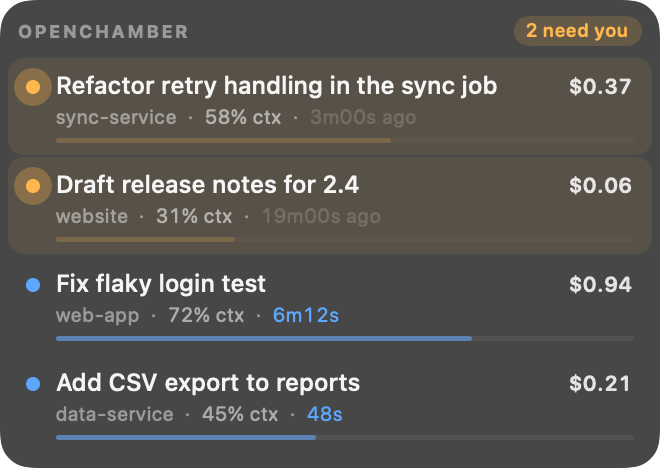
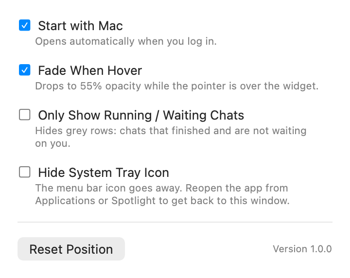

# OpenChamber Mini Status

A small always-on-top widget that shows what your OpenChamber chats are doing: four rows, no window chrome, sitting in a corner until you look at it. It ships as a normal app you can drag into Applications, with an icon in the menu bar.

Each row carries the chat title, where it lives, how much of the model's context window it has used, what it has cost so far, and how long it has been running or how long ago it finished. Chats that finished a turn stay in the list, pulsing amber until you open them. Click one and OpenChamber opens that chat.



## What it does

- Four rows. Chats that need you sit on top, everything else keeps the slot it already had, so background replies never reshuffle the list; new chats join at the end. Running means the chat's session is busy, or a background shell it started is still going, the same two signals OpenChamber's sidebar draws its blue icon from.
- Context window percentage per chat, counted the way the model sees it (input, output, reasoning, cache read and write). The bar turns red past 85%, where compaction starts to loom.
- Cost in dollars, and a clock: how long the current turn has been running, or how long ago the last one finished.
- A chat that just finished keeps its blue row for five seconds before it turns grey or drops out, so the list does not blink while OpenChamber catches up.
- Always on top, borderless, vibrant, and it fades to 55% opacity under the cursor so you can see what is behind it.
- Drag it anywhere; the position is remembered. Right-click for settings, reset position, refresh and quit.
- A menu bar icon with Settings and Quit.
- Starts at login through the system login item, which you can turn off in Settings or in System Settings > General > Login Items.
- Archived chats and subagent chats are left out unless something is happening in them: resuming an archived chat, or it waiting on you, brings it back.

## Requirements

- macOS 13 or newer (Apple silicon or Intel).
- The OpenChamber desktop app for the data. The widget reads the same local state OpenChamber already has, so it has nothing to show when OpenChamber has never run.

## Install

### From a release

Download `OpenChamber-Mini-Status-1.0.0.dmg` from [Releases](https://github.com/Timothylock/OpenChamber-Mini-Status/releases), open it, and drag **OpenChamber Mini Status** onto the Applications folder next to it. Then launch it from Applications.

The build is signed ad hoc, not notarized, so the first launch may be blocked. Open it once with right-click > Open, or clear the download flag:

```sh
xattr -d com.apple.quarantine "/Applications/OpenChamber Mini Status.app"
```

There is a `.zip` next to the disk image if you would rather unzip the app yourself.

The app has no Dock icon. It appears as the widget, as an icon in the menu bar, and as a login item.

### From source

Needs Xcode Command Line Tools for `swiftc`: `xcode-select --install`.

```sh
git clone https://github.com/Timothylock/OpenChamber-Mini-Status.git
cd OpenChamber-Mini-Status
make install
```

`make install` builds a release binary, wraps it in `OpenChamber Mini Status.app`, copies it to `~/Applications`, and launches it.

### Uninstall

Quit from the menu bar icon, then drag the app to the Trash. If it still shows in System Settings > General > Login Items, remove it there. From a source checkout, `make uninstall` does all of that.

## Using it

- Click a row to open that chat in OpenChamber. It stops pulsing.
- Drag anywhere on the widget to move it.
- Hover to fade it out, move away and it comes back.
- Right-click the widget, or click the menu bar icon, for Settings and Quit.

Dot colours: amber pulsing means a turn finished and you have not opened it yet; the row stays there however long you leave it, like OpenChamber's green unread mark. Blue means a turn is running or a background command is still going (the clock turns blue too), grey is everything else. Only the dot, clock and context bar pulse, so the row itself never flashes.

## Settings

Open Settings from the menu bar icon (or by right-clicking the widget). Four switches:



| Switch | What it does |
| --- | --- |
| Start with Mac | Registers the app as a login item so it opens automatically. Unchecking removes it. Only available when the app is in Applications. |
| Fade When Hover | Drops to 55% opacity while the pointer is over the widget. Off keeps it fully readable. |
| Only Show Running / Waiting Chats | Drops the grey rows: chats that finished and are not waiting on you. The four-row limit is lifted while this is on, so every running or waiting chat shows. |
| Hide System Tray Icon | Removes the menu bar icon. To get back here, launch the app again from Applications or Spotlight: a second launch just reopens this window. |

The window also has Reset Position, which puts the widget back in the bottom-right corner.

## How it reads your data

Nothing leaves the machine and no permissions are needed. The widget only reads:

| Source | What for |
| --- | --- |
| `~/.local/share/opencode/opencode.db` (read-only) | titles, cost, tokens, timestamps, model |
| `~/.config/openchamber/sessions-archive.json` and `sessions-directories.json` | which chats are archived, so finished ones stay out of the list |
| `~/.config/openchamber/settings.json` | the desktop server's port and client token |
| `http://127.0.0.1:<port>/api/sessions/status` | which chats are running (`status: busy`) and which are blocked on a permission request, question or form (`pending`), straight from OpenChamber's own watcher |
| `~/.config/openchamber/managed-opencode/*.json` plus `/bin/ps` on that pid | the local opencode server's port and its password |
| `http://127.0.0.1:<port>` on that server | the token count of each chat's last completed request, per-model context windows, and `/api/shell` for background commands still running |

Running and blocked come from OpenChamber when it is up, so the widget matches its sidebar instead of guessing. That endpoint wants the client token OpenChamber writes into its settings file; the widget reads the token locally and sends it back as a bearer token to 127.0.0.1. A chat whose turn ended but whose background shell is still running stays blue, because OpenChamber's own sidebar keeps its terminal icon there.

Read state is the one thing OpenChamber keeps inside its window and exposes nowhere, so the widget uses its own: a turn that ended after the widget started is unread until you click it, and it stays in the list however long that takes. Turns that ended earlier stay grey, which matches a fresh OpenChamber launch. When OpenChamber's desktop API is off or refuses the token, the widget asks the managed opencode server directly which sessions are running and which are blocked on a permission request or form, then uses the database for the rest: the In work flag for running, and the same finished-turn rule for waiting.

Context usage is not in the database. The v2 session rows only keep lifetime totals, so the widget asks the managed opencode server that OpenChamber runs, which knows how large each request was. When OpenChamber is not running there is no server to ask, and rows fall back to the chat's plain token total.

## Configuration

Everything tunable lives in `Sources/Core/Config.swift`: row count, polling intervals, window width, the opacity it fades to, and the compaction warning threshold. Change a value, then `make install` again.

`MINI_STATUS_DB` overrides the session database path, which is mainly useful for testing against a copy.

## Development

```sh
make build            # compile the binary
make test             # run the test executable
make snapshot         # render the widget to build/hud.png
make docs             # regenerate the README screenshots in docs/
make bundle           # build the .app bundle with its icon
make run              # bundle and open it
make dist             # disk image and zip for a release
```

Layout:

```
Sources/Core/   data reading, phase rules, formatting, context fetching, preferences
Sources/App/    SwiftUI views, the floating panel, menu bar item, settings, entry point
Tests/          executable test harness (the toolchain here has no SwiftPM)
scripts/        bundle, icon, install, uninstall, dist
```

`make docs` regenerates the images in `docs/` from invented chats (`--snapshot-demo`) and the settings window (`--snapshot-settings`), so no real project names end up in the README. `make snapshot` instead renders the live widget with your own data. Neither needs screen recording permission.

### Releasing

`.github/workflows/release.yml` builds the artifacts on GitHub's macOS runner. Either push a tag:

```sh
git tag v1.2.3 && git push origin v1.2.3
```

or publish a release by hand in the GitHub UI. The workflow runs the tests, builds `OpenChamber-Mini-Status-<version>.dmg` and the matching zip, and attaches both to that release. The tag name without the leading `v` becomes the bundle version. Builds are ad hoc signed, not notarized.

Logs land in Console under subsystem `dev.openchamber.mini-status`:

```sh
log stream --predicate 'subsystem == "dev.openchamber.mini-status"' --level debug
```

## Troubleshooting

**It says "waiting for OpenChamber".** The session database is not readable yet. Open OpenChamber once.

**Rows show a token count instead of a percentage.** The context probe has no server yet: OpenChamber is closed, just started, or the model is not in the catalog. It recovers on the next poll.

**The panel is under another window.** It floats above normal windows but not above full-screen apps or menus. Reset Position from Settings if it ends up somewhere awkward.

**The menu bar icon is gone.** It was hidden in Settings. Launch the app again from Applications or Spotlight and the settings window comes back.

**"Start with Mac" is greyed out.** The app is running from somewhere other than an Applications folder. Move it there and reopen.

**Nothing appears after `make install`.** Check that the app started: `pgrep -fl mini-status`. Running it from Terminal shows the error: `"/Applications/OpenChamber Mini Status.app/Contents/MacOS/mini-status"`.

## License

Apache 2.0, see [LICENSE](LICENSE).
